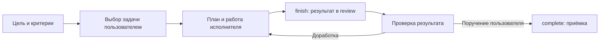

# control-workflow

Панель на Rust с CLI и локальным MCP stdio: [сборка и подключение MCP](docs/rust.md),
[установка и обновление](docs/install.md). Проекты, задачи и запуски хранятся в файлах.

Локальный workflow для работы с агентами: пользователь выбирает задачу,
управляющий задаёт цель и критерии, исполнитель выполняет работу в herdr,
а результат и контекст остаются в файлах. Это помогает продолжить задачу после
остановки агента и проверить результат до приёмки.

## Проекты, задачи и запуски

Проект объединяет задачи одной цели или области работы. В его описании хранится
общий контекст, а в проектной памяти — решения, проверенные знания и отчёты,
которые можно найти для следующих задач. Задача задаёт конкретную цель и критерии
готовности; запуск — отдельная попытка её выполнить, со своим заданием, планом,
статусом и артефактами. У одной задачи может быть несколько запусков.

К проекту можно привязать один или несколько Git-репозиториев и рабочее
пространство herdr. Локальные пути и привязки хранятся отдельно от описания
проекта. Репозиторий необязателен: проект подходит и для исследований, проверки
документов или применения готовых настроек. Для изменения файлов репозитория
нужна задача с кодом; она использует репозитории проекта или явно заданные
репозитории задачи. Подробнее — [настройка проекта](skills/control-project/SKILL.md),
[память](skills/control-memory/SKILL.md) и [расположение данных](docs/runtime-layout.md).

## Как устроена работа

Управляющий ведёт проекты и задачи через CLI панели и запускает только выбранные
пользователем задачи. Каждый запуск получает assignment.md
и каталог для плана и артефактов. Исполнитель читает задание, показывает и сохраняет план,
выполняет работу и проверки. Для изменений кода он работает в отдельном Git
worktree; чтение и применение готовых настроек выполняются без worktree.



План описывает оставшиеся шаги. Если работу нужно отложить, checkpoint сохраняет
текущее состояние, проверки и следующий шаг. Отчёт и решения хранятся рядом с
заданием, поэтому продолжение не зависит от сохранности переписки.
Команда finish передаёт результат в review. Пользовательская приёмка через
complete закрывает задачу и сохраняет код по выбранному Git-режиму.
[Контракт исполнителя](docs/worker.md), [восстановление](docs/recovery.md) и
[Git-приёмка](docs/git-policy.md) описывают этот порядок подробнее.

[Пример команд](examples/task.md) воспроизводит этот цикл в отдельном экземпляре
без изменения кода.

## Первый запуск

Нужны Linux/macOS, herdr и авторизованный CLI агента; для задач с кодом —
Git. Для сборки из исходников установи Rust 1.91.0 и linker платформы
(на macOS — Xcode Command Line Tools). Из корня checkout:

```sh
cargo build --locked --release
target/release/control-workflow install --prefix "$HOME/.local/share/control-workflow/program"
```

Готовая поставка работает без Python и Rust toolchain. Для обновления собери
новый бинарник и повтори install с прежним prefix: установщик проверяет старые
файлы, сохраняет backup и оставляет state/config/bindings на месте.
[Пошаговая установка](docs/install.md) ведёт от установки зависимостей до новой
сессии herdr и управляющего Codex с восемью скиллами и явно выбранным экземпляром.

Программа, пользовательский config, привязки машины и state хранятся раздельно.
Дистрибутив содержит исходники и синтетические примеры. Проекты, задачи,
запуски и память создаются в своём state; credentials остаются в штатном
хранилище CLI провайдера. Пути показывает environment:
[выбор экземпляра](docs/control-entry.md), [расположение данных](docs/runtime-layout.md).

CLI принимает пути перед подкомандой. Для нового экземпляра в свободных каталогах
создай config по примеру и проверь выбранные пути:

```sh
mkdir -p "$HOME/.config/control-workflow-demo"
cp "$HOME/.local/share/control-workflow/program/examples/config-codex.json" \
  "$HOME/.config/control-workflow-demo/config.json"
"$HOME/.local/share/control-workflow/program/bin/control-workflow" \
  --state-root "$HOME/.local/state/control-workflow-demo" \
  --bindings-root "$HOME/.local/state/control-workflow-demo-bindings" \
  --config "$HOME/.config/control-workflow-demo/config.json" environment
```

В выводе environment сверь state_root, bindings_root и config с выбранными путями.
Для подключения MCP stdio используй те же параметры и подкоманду mcp;
пример конфигурации клиента — в [инструкции CLI/MCP](docs/rust.md).
При вызове панели вне herdr передавай --herdr-session NAME перед подкомандой.

Для встроенной политики моделей добавь `"model_policy": "builtin"`
в пользовательский config. Она выбирает sol для normal и sol-high для complex;
пример Codex уже включает её. Именованный профиль задаётся, например,
через --profile sol-high при создании задачи или запуске; без политики
сохраняются прежние настройки. [Профили и миграция config](docs/model-policy.md)
описывают выбор модели, локальные переопределения и ограничения.

## Возможности скиллов

Скиллы помогают управляющему выбрать команды панели и соблюдать порядок работы.
Подробные инструкции — по ссылкам в таблице.

| Скилл | Что делает и когда нужен |
| --- | --- |
| [control-list](skills/control-list/SKILL.md) | Показывает проекты, задачи, статусы и ожидающие ответа вопросы, когда нужен краткий обзор. |
| [control-project](skills/control-project/SKILL.md) | Создаёт и настраивает проект: описание, репозитории и пространство herdr. Нужен для новой области работы или изменения её привязок. |
| [control-task](skills/control-task/SKILL.md) | Создаёт и правит задачи: цель, критерии, зависимости, тип и сложность работы, приёмщик. Нужен для подготовки задания. |
| [control-start](skills/control-start/SKILL.md) | Открывает выбранные пользователем задачи; переиспользует работающего исполнителя, восстанавливает подтверждённый старт или создаёт запуск. Нужен, чтобы начать или продолжить работу. |
| [control-review](skills/control-review/SKILL.md) | Показывает прогресс, вопросы и результат; помогает разобрать блокировку или сбой запуска, вернуть работу на доработку, отправить на агентское ревью. Нужен для проверки хода и результата работы. |
| [control-complete](skills/control-complete/SKILL.md) | По поручению пользователя принимает, завершает или отменяет задачу, выполняет Git-завершение и закрывает исполнителя. Нужен для окончательной приёмки или отмены. |
| [control-memory](skills/control-memory/SKILL.md) | Ищет и сохраняет решения, знания и отчёты в памяти проекта или общей памяти. Нужен, чтобы использовать прежний опыт и сохранить новые выводы. |
| [control-sync](skills/control-sync/SKILL.md) | По запросу сверяет записи панели и документацию с фактическим состоянием проектов и ресурсов, вносит подтверждённые исправления. Нужен для актуализации состояния. |

## Поддержка

Это экспериментальный выпуск. На Linux ранее пройден no-code цикл с реальным CLI Codex;
полный code/recovery и обнаружение скиллов реальным CLI ещё требуют проверки.
Claude Code — экспериментальный адаптер без приёмки с реальным CLI. macOS — целевая
платформа с подготовленным CI, без подтверждённого прогона. Windows и
распределённый state не поддерживаются. [Матрица проверок](docs/compatibility.md)
отделяет выполненные проверки от запланированных.

## Проверки исходников

```sh
python3 -m venv target/check-venv
. target/check-venv/bin/activate
python3 -m pip install -r requirements-dev.txt
sh scripts/check.sh
```

Общая команда для локальной проверки и CI выполняет Rust fmt/clippy,
Ruff, Rust-тесты, release-сборку, аудит и Python-контракты с release-бинарником.
Ruff проверяет синтаксис, неиспользуемые импорты и неопределённые имена
в тестах и аудите; версия закреплена в requirements-dev.txt.
Python 3.10+ и модуль venv нужны разработчику для этих проверок.
Тесты вызывают Rust CLI/MCP, используют временные Git/state/config/bindings и fake herdr;
модели и табы herdr не запускаются. CI настроен на Linux/macOS x86_64/ARM64;
наличие workflow не означает успешный запуск CI. Release audit сверяет
положительный список файлов, хеши, локальные Markdown-ссылки и все достижимые
Git-деревья по встроенным шаблонам секретов и личных данных. Такой поиск не
гарантирует обнаружения произвольного секрета; метаданные Git требуют отдельной
проверки перед публикацией. После изменения файлов поставки обнови хеши командой
`python3 scripts/release_audit.py --write-manifest` и повтори проверку.

## Лицензия

[MIT](LICENSE). История Git сохранена с исходными метаданными авторов.
