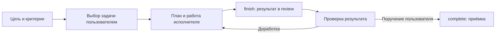

# control-workflow

Локальный workflow для работы с агентами: пользователь выбирает задачу,
управляющий задаёт цель и критерии, исполнитель выполняет работу в herdr,
а результат и контекст остаются в файлах. Это помогает продолжить задачу после
остановки агента и проверить результат до приёмки.

## Как устроена работа

Управляющий ведёт проекты и задачи через CLI панели и запускает только выбранные
пользователем задачи. Каждая задача получает отдельный запуск с assignment.md,
планом и артефактами. Исполнитель читает задание, показывает и сохраняет план,
выполняет работу и проверки. Для изменений кода он работает в отдельном Git
worktree; чтение и применение готовых настроек выполняются без worktree.



План описывает оставшиеся шаги. Если работу нужно отложить, checkpoint сохраняет
текущее состояние, проверки и следующий шаг. Отчёт и решения хранятся рядом с
заданием, поэтому продолжение не зависит от сохранности переписки.
Команда finish передаёт результат в review. Пользовательская приёмка через
complete закрывает задачу и сохраняет код по выбранному Git-режиму.
[Контракт исполнителя](docs/worker.md), [восстановление](docs/recovery.md) и
[Git-приёмка](docs/git-policy.md) описывают этот порядок подробнее.

## Пример

В вымышленном проекте «Справочник» пользователь выбирает задачу «Проверить
инструкцию». Цель — найти неоднозначные шаги; критерий — отчёт с примерами и
предложениями. Управляющий открывает эту задачу, исполнитель сохраняет план,
проверяет текст и передаёт отчёт через finish. Пользователь читает результат,
просит уточнить один шаг, затем поручает complete. В хранилище остаются задание,
план, отчёт и решения. [Пример команд](examples/task.md) воспроизводит такой цикл
в отдельном экземпляре без изменения кода.

## Первый запуск

Нужны Python 3.10+, POSIX, herdr и авторизованный CLI агента; для задач с кодом —
Git. Python-часть использует только стандартную библиотеку.
[Пошаговая установка](docs/install.md) ведёт от установки зависимостей до новой
сессии herdr и управляющего Codex с восемью скиллами и явно выбранным экземпляром.

Программа, пользовательский config, привязки машины и state хранятся раздельно.
Дистрибутив содержит исходники и синтетические примеры. Проекты, задачи,
запуски и память создаются в своём state; credentials остаются в штатном
хранилище CLI провайдера. Пути показывает environment:
[выбор экземпляра](docs/control-entry.md), [расположение данных](docs/runtime-layout.md).

## Поддержка

Это экспериментальный выпуск. На Linux ранее пройден no-code цикл с реальным CLI Codex;
полный code/recovery и обнаружение скиллов реальным CLI ещё требуют проверки.
Claude Code — экспериментальный адаптер без приёмки с реальным CLI. macOS — целевая
платформа с подготовленным CI, без подтверждённого прогона. Windows и
распределённый state не поддерживаются. [Матрица проверок](docs/compatibility.md)
отделяет выполненные проверки от запланированных.

## Проверки исходников

```sh
PYTHONDONTWRITEBYTECODE=1 python3 -m unittest discover -s tests -v
python3 scripts/release_audit.py
```

Тесты используют временные Git/state/config/bindings и fake herdr; модели
и табы herdr не запускаются. CI настроен на Linux/macOS с Python 3.10 и 3.13;
наличие workflow не означает успешный запуск CI. Release audit сверяет
положительный список файлов, хеши, локальные Markdown-ссылки и все достижимые
Git-деревья по встроенным шаблонам секретов и личных данных. Такой поиск не
гарантирует обнаружения произвольного секрета; метаданные Git требуют отдельной
проверки перед публикацией.

## Лицензия

[MIT](LICENSE). История Git сохранена с исходными метаданными авторов.
