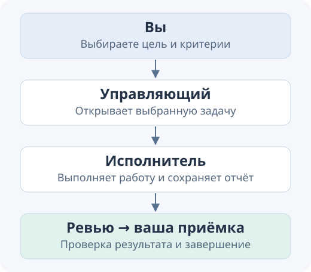

# control-workflow

Локальная панель для работы с агентами Codex и Claude Code. Вы описываете задачу,
агент выполняет её в отдельном терминале, а вы проверяете результат и принимаете работу.
Планы, отчёты и состояние сохраняются в файлах — к задаче можно вернуться после перерыва.

<a href="https://bragaman.github.io/control-workflow/docs/guide/installation/" class="md-button md-button--primary">Начать работу</a>
<a href="https://bragaman.github.io/control-workflow/docs/guide/first-task/" class="md-button">Первая задача</a>

## Как устроена работа

Проект объединяет контекст и задачи. У каждой задачи есть цель, критерии готовности
и один или несколько запусков с планом и результатами.

Для изменения кода панель создаёт отдельный Git worktree. Исследования и применение
готовых настроек можно выполнять без него. Завершённую работу агент передаёт на
проверку; приёмка и публикация требуют вашего поручения.

## Дальше

- [Установка](https://bragaman.github.io/control-workflow/docs/guide/installation/) — зависимости и подготовка экземпляра.
- [Первая задача](https://bragaman.github.io/control-workflow/docs/guide/first-task/) — пройти цикл от постановки до приёмки.
- [Работа с задачами](https://bragaman.github.io/control-workflow/docs/guide/workflow/) — статусы, вопросы, ревью и Git.
- [Настройки](https://bragaman.github.io/control-workflow/docs/guide/settings/) — хранение данных, агент и модели.
- [Справка](https://bragaman.github.io/control-workflow/docs/guide/reference/) — команды и решение типичных проблем.

Выпуск экспериментальный. Целевые платформы — Linux x86_64/ARM64 и macOS ARM64.
Автотесты не подтверждают полный цикл с реальным CLI агента: для Claude Code
такой цикл ещё не подтверждён; для Codex на Linux проверен сценарий без кода.
Windows и macOS Intel не поддерживаются.

[Сайт документации](https://bragaman.github.io/control-workflow/) ·
[Исходный код](https://github.com/Bragaman/control-workflow) · [Лицензия MIT](LICENSE)
