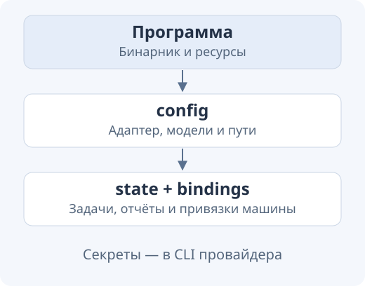

# Настройки и данные

Программа, данные и настройки выбираются отдельно. Это позволяет обновлять панель,
сохраняя проекты и историю, или работать с несколькими экземплярами на одной машине.



## Каталоги

| Что | Назначение |
| --- | --- |
| Программа | Бинарник и поставляемые ресурсы |
| state | Проекты, задачи, запуски, отчёты и память |
| bindings | Пути репозиториев, терминалы и другие привязки к машине |
| config | Адаптер, модели, режим Git и пути экземпляра |

State по умолчанию: Linux — `$XDG_STATE_HOME/control-workflow`, иначе
`~/.local/state/control-workflow`; macOS — `~/Library/Application Support/control-workflow/state`.
Bindings по умолчанию находится в state/bindings. Config — отдельный JSON.
Фактические значения показывает команда environment.

## Явный выбор экземпляра

Параметры CLI имеют приоритет над переменными окружения и конфигурацией:

```sh
/path/to/program/bin/control-workflow \
  --state-root /path/to/state \
  --bindings-root /path/to/bindings \
  --config /path/to/config.json \
  environment
```

Замените пути реальными абсолютными путями. Все общие параметры указываются перед
подкомандой. Для TUI вне herdr добавьте `--herdr-session ИМЯ`, предварительно проверив имя
через `herdr session list`.

## Агент и модели

```json
{
  "adapter": "herdr-codex",
  "git_mode": "branch",
  "model_policy": "builtin"
}
```

Адаптеры `herdr-codex` и `herdr-claude` запускают исполнителей в штатном TUI.
Изменение настройки действует для новых запусков. Встроенная политика
выбирает профиль по типу и сложности задачи. Собственные модели задаются в model_overrides;
наличие модели у провайдера панель не проверяет. Для Claude подготовьте политику
с доступными вам моделями.

Credentials храните в штатном хранилище CLI провайдера. Не добавляйте их в задачи,
отчёты или память панели. При использовании MCP изменение config требует перезапуска
процесса сервера.

## Подключение к исполнителю через Herdr Core

После [установки herdr-core](installation.md) задайте в config `"adapter": "hc-codex"`.
Имя сессии задаёт поле `hc_session` в `bindings/runtime.json` (по умолчанию
`default`). Для существующих TUI-запусков оставьте `herdr` доступным.

- **Herdr Desktop.** Подключите Desktop к машине исполнителя и той же сессии hc.
  Для удалённой машины используйте SSH.
- **Штатный Herdr TUI.** После старта задачи вызовите `open TASK_ID`. В панели
  TUI на машине исполнителя удалите переменные из `hc.attach.unset_env`,
  задайте значения из `hc.attach.env` и выполните `hc.attach.argv`.
  Сохраняйте полный адрес вида `CORE_ID/t1`: локальный `t1` может встречаться
  на нескольких машинах. Для отсоединения нажмите `Ctrl+\`. При следующем
  подключении откроется тот же диалог.
- **Свой клиент.** В CLI вызовите `run RUN_ID --compact`, в MCP — `run`
  с `id` и `compact: true`. В объекте `hc` находятся `machine`, `session`,
  `core_id`, `address` и `agent_status`. При прямом подключении к машине
  исполнителя через `hc connect --session NAME` сверьте `server.status`
  (`result.core.id`) с `hc.core_id`, затем запросите `terminal.get` по `hc.address`.
