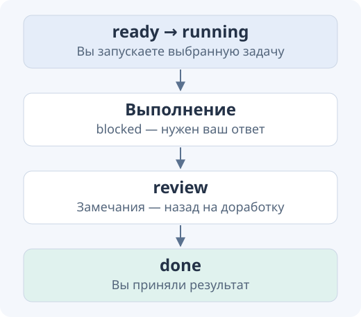

# Работа с задачами

Запускаются только выбранные вами задачи. Управляющий ведёт проекты и постановки,
исполнитель выполняет конкретное задание, пользователь принимает результат.

## Жизненный цикл

| Статус | Что делать |
| --- | --- |
| backlog | Уточнить цель и критерии |
| ready | Выбрать задачу для запуска |
| running | Смотреть прогресс; при необходимости уточнять задание |
| blocked | Ответить на вопрос или устранить препятствие |
| review | Проверить результат и независимое ревью |
| done | Работа принята |
| cancelled | Работа отменена |

## Постановка

Укажите, что должно получиться и как это проверить. Добавьте ограничения: какие
репозитории можно менять, допустимы ли внешние действия, кто принимает работу.
Для кода выберите режим Git; для исследования или применения готовых настроек — работу без кода.

Проект может содержать несколько задач. У каждой попытки выполнения свой запуск
с заданием, планом, отчётом и артефактами. Повторный запуск не стирает прежний результат.

## Вопросы и продолжение

Если агент ждёт ответа, попросите управляющего показать вопрос и передайте ответ ему.
После ответа на вопрос агент продолжает тот же запуск; план и прогресс уже сохранены.
После неизвестного исхода запуска не открывайте второй терминал вслепую:
сначала попросите проверить состояние задачи.

## Ревью и приёмка

В режиме auto после сдачи исполнитель вызывает независимого проверяющего.
При замечаниях он исправляет работу и сдаёт её повторно. Успешное ревью оставляет
задачу в review. Публикация и завершение выполняются только по вашему поручению.

Попросите показать результат в чате, затем примите работу или перечислите исправления.
Публикацию без закрытия задачи можно поручить отдельно.

## Git

| Режим | Что произойдёт при приёмке |
| --- | --- |
| main | Коммит и слияние в основную ветку; push, если есть origin |
| branch с origin | Коммит и push отдельной ветки; слияние выполняете вы |
| branch без origin | Локальное слияние в основную ветку |

Коммит требует конкретного сообщения на английском. После успешных Git-операций
временный worktree удаляется вместе с локальными файлами, если его не использует
другая незавершённая задача. Поэтому нужные результаты
исполнитель сохраняет вне него. При ошибке публикации работа остаётся доступной для исправления.
Отмена задачи не отменяет уже выполненный push.
